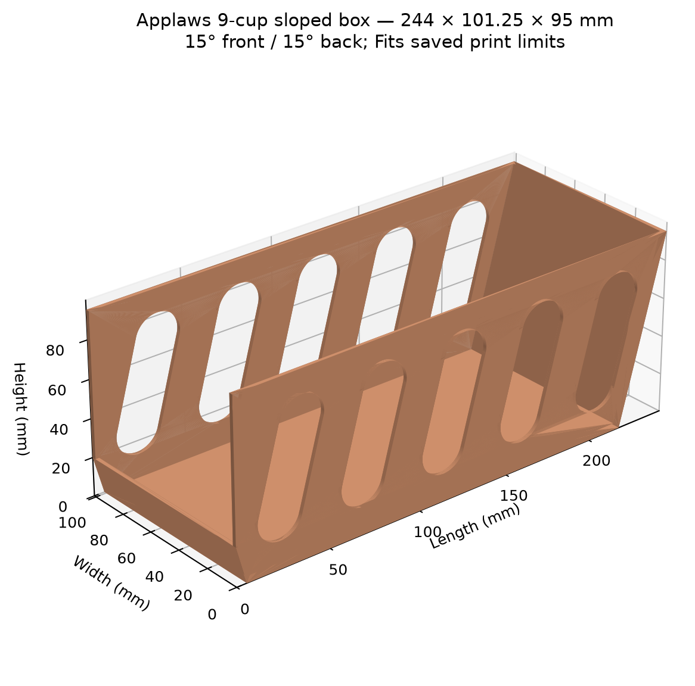

---

title: "Applaws Cup Organizer"  
date: "2026-10-19"  
order: 3  
status: "Almost real"  
summary: "Applaws natural cat food is great for this requester’s cat, but the cups are hard to organize. Once you open the box, you’re left with a janky cardboard box sitting on the shelf. The goal is a clean way to hold up to 10 cups."  
model: "/images/experiments/applaws/applaws.glb"
image: "/images/experiments/applaws/applaws.png"
description: "A 3D-printed shelf organizer that holds up to 10 Applaws cat food cups, instead of the cardboard box they ship in."

---

## Using AI for 3D Draft

This is my second time using AI specifically ChatGPT to take input from basic measurements and a few websites to generate this 3-D model. The best part about it is is initial renderings are actually done through a Python script. It gives me an opportunity to quickly make edits and immediately generate updates. This one particular was a little bit trickier because it had a slope on the front and on the back, which AI isn't really good at visualizing, so I had to put in the measurements myself. Here's the final Python script. I'm not sure that it's any faster in the design phase, but it is faster on rendering permutations. When you do it by hand, which I use shape for 3D, it's actually pretty quick, but if there's nuances or slight little variances, which in this case was the case, for example, I think we had iterations of 200mm x 100mm x 90 mm to its final design of 240x100x95.

<figure class="post-figure">

<figcaption>The Python script's preview render: 9-cup sloped box, 244 × 101.25 × 95 mm, 15° front and back.</figcaption>
</figure>

<details class="code-details">
<summary>Show the Python script (applaws.py)</summary>

```python
"""Applaws box with 15-degree sloped front lip and back, and side punchouts.

Run: python3 applaws.py
Requires CadQuery and Matplotlib. All model dimensions are millimeters.
Source: user's ruler photos (~240 x 100 x 95 mm cardboard box) and measured
cups (3 3/4 inches wide/tall, 7/8 inch deep). Photo dimensions are approximate.
The approved box layout has tall sides, a low front, and no individual dividers.
Nine cups fit the saved 245 mm print limit. Ten cups need about 267.2 mm length.
For the larger reference model set CUP_COUNT=10 and ALLOW_OVERSIZE_EXPORT=True.
"""

from datetime import datetime
from pathlib import Path
import math

import cadquery as cq
import matplotlib
import numpy as np
matplotlib.use("Agg")
import matplotlib.pyplot as plt
from mpl_toolkits.mplot3d.art3d import Poly3DCollection

# Product identity from the manufacturer and linked retailer, checked 2026-10-19.
PRODUCT_BRAND = "Applaws"
PRODUCT_NAME = "Tuna Fillet & Salmon Recipe in Broth"
PRODUCT_CODE = "7018US-A"
PRODUCT_PACKAGE_TYPE = "cup"
PRODUCT_NET_WEIGHT_OZ = 2.12  # Food net weight, not fluid ounces or cup volume.
PRODUCT_CASE_QUANTITY = 10
PRODUCT_URL = "https://www.chewy.com/applaws-tuna-fillet-salmon-recipe-in/dp/1074134"
MANUFACTURER_URL = "https://applaws.com/us/products/tuna-fillet-salmon-recipe-in-broth/"

# ------------------------------- Cup dimensions -------------------------------
MM_PER_INCH = 25.4  # Exact conversion.
CUP_DIAMETER_MM = 3.75 * MM_PER_INCH  # 95.25 mm maximum package width AND height.
CUP_PACKAGE_DEPTH_MM = 0.875 * MM_PER_INCH  # 22.225 mm full sealed-cup depth.
CUP_COUNT = 9  # Printable default; ten cups with these slopes exceed the bed.
CUP_CLEARANCE_MM = 1.0  # Minimum space on EACH side across the channel width.
CUP_GAP_MM = 1.0  # Free space between consecutive upright cups; no partitions.
CUP_END_CLEARANCE_MM = 1.0  # Minimum space at each end of the loaded row.

# ------------------------------ Box dimensions --------------------------------
# Approximate OUTSIDE dimensions read from the user's ruler photographs.
SOURCE_BOX_LENGTH_MM = 240.0
SOURCE_BOX_WIDTH_MM = 100.0
SOURCE_BOX_HEIGHT_MM = 95.0
FLOOR_THICKNESS = 2.0  # Continuous flat printable floor.
WALL_THICKNESS = 2.0  # Uniform thickness of sides, back, and low front lip.
# The width is slightly larger than the photo estimate so measured cups have
# 1 mm side clearance. Default outside width is 101.25 mm; inside is 97.25 mm.
WIDTH = max(SOURCE_BOX_WIDTH_MM,
            CUP_DIAMETER_MM + 2 * CUP_CLEARANCE_MM + 2 * WALL_THICKNESS)
WALL_HEIGHT = SOURCE_BOX_HEIGHT_MM  # 95 mm overall side and back height.
FRONT_WALL_HEIGHT = 20.0  # Low retaining lip, measured up from the outside bottom.
BACK_SLOPE_DEG = 15.0  # Outward lean of the tall back, measured from vertical.
FRONT_SLOPE_DEG = 15.0  # Outward lean of the 20 mm front lip, from vertical.
# Above the front lip, the side-wall front corners remain vertical. This keeps
# the display-box access opening while sloping the entire retaining lip.
# All exposed edges are sharp: no chamfers or fillets. Only the punchout profiles
# are rounded, following the earlier holder's elongated side openings.

# ------------------------------- Side punchouts -------------------------------
# Five larger openings per side leave stronger ribs than ten narrow tall holes.
# Height grows from the prior 36 mm slot to 70 mm; width grows from 18 to 24 mm.
SIDE_SLOT_COUNT = 5
SIDE_SLOT_HEIGHT = 70.0  # Full capsule length, including its semicircular ends.
SIDE_SLOT_WIDTH = 24.0  # Capsule width / end-circle diameter.
SIDE_SLOT_ANGLE_DEG = 75.0  # In the XZ side view: 90 degrees would be vertical.
SIDE_SLOT_MARGIN_MM = 10.0  # Minimum frame at the floor, rim, front and back.
MIN_SIDE_RIB_MM = 8.0  # Minimum solid gap between adjacent slot bounding boxes.

# ---------------------------- Fit and print limits ----------------------------
MAX_PRINT_LENGTH_MM = 245.0  # Conservative saved one-piece print envelope.
MAX_PRINT_WIDTH_MM = 245.0
MAX_PRINT_HEIGHT_MM = 256.0  # X1C build height.
ALLOW_OVERSIZE_EXPORT = False  # True only for deliberately oversized reference CAD.
MAX_SHELF_HEIGHT_MM = 4.5 * MM_PER_INCH  # 114.3 mm from the user's shelf sketch.
MAX_SHELF_DEPTH_MM = 16.0 * MM_PER_INCH  # 406.4 mm maximum front-to-back depth.
PACK_LENGTH_MM = CUP_COUNT * CUP_PACKAGE_DEPTH_MM + (CUP_COUNT - 1) * CUP_GAP_MM
front_angle = math.radians(FRONT_SLOPE_DEG)
back_angle = math.radians(BACK_SLOPE_DEG)
FRONT_RUN_MM = FRONT_WALL_HEIGHT * math.tan(front_angle)
BACK_RUN_MM = WALL_HEIGHT * math.tan(back_angle)
# Preserve normal wall thickness on each sloped end. Size the widest envelope
# from the available interior at floor height, where the cup row is tightest.
MIN_LENGTH_MM = (PACK_LENGTH_MM + 2 * CUP_END_CLEARANCE_MM
                 + WALL_THICKNESS / math.cos(front_angle)
                 + WALL_THICKNESS / math.cos(back_angle)
                 + (FRONT_WALL_HEIGHT - FLOOR_THICKNESS) * math.tan(front_angle)
                 + (WALL_HEIGHT - FLOOR_THICKNESS) * math.tan(back_angle))
LENGTH = max(SOURCE_BOX_LENGTH_MM, math.ceil(MIN_LENGTH_MM * 10) / 10)
FRONT_BASE_X_MM = FRONT_RUN_MM
BACK_BASE_X_MM = LENGTH - BACK_RUN_MM
INNER_FRONT_AT_FLOOR_MM = (FRONT_RUN_MM - FLOOR_THICKNESS * math.tan(front_angle)
                           + WALL_THICKNESS / math.cos(front_angle))
INNER_BACK_AT_FLOOR_MM = (BACK_BASE_X_MM + FLOOR_THICKNESS * math.tan(back_angle)
                          - WALL_THICKNESS / math.cos(back_angle))
INTERNAL_LENGTH = INNER_BACK_AT_FLOOR_MM - INNER_FRONT_AT_FLOOR_MM
INTERNAL_WIDTH = WIDTH - 2 * WALL_THICKNESS
PRINT_FITS = (LENGTH <= MAX_PRINT_LENGTH_MM and WIDTH <= MAX_PRINT_WIDTH_MM
              and WALL_HEIGHT <= MAX_PRINT_HEIGHT_MM)
LOADED_HEIGHT_MM = max(WALL_HEIGHT, FLOOR_THICKNESS + CUP_DIAMETER_MM)
slot_angle = math.radians(SIDE_SLOT_ANGLE_DEG)
SLOT_X_SPAN_MM = ((SIDE_SLOT_HEIGHT - SIDE_SLOT_WIDTH) * abs(math.cos(slot_angle))
                  + SIDE_SLOT_WIDTH)
SLOT_Z_SPAN_MM = ((SIDE_SLOT_HEIGHT - SIDE_SLOT_WIDTH) * abs(math.sin(slot_angle))
                  + SIDE_SLOT_WIDTH)
SLOT_CENTER_Z_MM = (FLOOR_THICKNESS + WALL_HEIGHT) / 2
# Respect the sloped end boundaries when locating the enlarged punchouts.
# The front bound is conservative across the slot's full vertical extent.
slot_bottom_z = SLOT_CENTER_Z_MM - SLOT_Z_SPAN_MM / 2
slot_front_bound = max(0.0, FRONT_RUN_MM - slot_bottom_z * math.tan(front_angle))
FIRST_SLOT_X_MM = slot_front_bound + SIDE_SLOT_MARGIN_MM + SLOT_X_SPAN_MM / 2
# Project the capsule onto x-z*tan(back_angle), the sloped back's plane.
slot_back_projection = ((SIDE_SLOT_HEIGHT - SIDE_SLOT_WIDTH) / 2
                        * abs(math.cos(slot_angle) - math.tan(back_angle) * math.sin(slot_angle))
                        + SIDE_SLOT_WIDTH / (2 * math.cos(back_angle)))
LAST_SLOT_X_MM = (BACK_BASE_X_MM + SLOT_CENTER_Z_MM * math.tan(back_angle)
                  - slot_back_projection - SIDE_SLOT_MARGIN_MM)
SLOT_PITCH_MM = (
    (LAST_SLOT_X_MM - FIRST_SLOT_X_MM) / (SIDE_SLOT_COUNT - 1)
    if SIDE_SLOT_COUNT > 1 else 0.0
)

OUTPUT_DIR = Path(__file__).resolve().parent / "outputs"
TIMESTAMP = datetime.now().strftime("%m%d_%H%M%S")  # Preserve timestamped versions.
FILE_STEM = f"Applaws_{CUP_COUNT}_Cup_Sloped_Box_{TIMESTAMP}"
STEP_FILE = OUTPUT_DIR / f"{FILE_STEM}.step"
PREVIEW_FILE = OUTPUT_DIR / f"{FILE_STEM}_preview.png"


def validate_product_fit() -> None:
    """Check cup clearance, shelf space, print limits, and side-wall frames."""
    positive_values = (LENGTH, WIDTH, WALL_HEIGHT, FLOOR_THICKNESS, WALL_THICKNESS,
                       CUP_DIAMETER_MM, CUP_PACKAGE_DEPTH_MM, SIDE_SLOT_HEIGHT,
                       SIDE_SLOT_WIDTH, SIDE_SLOT_MARGIN_MM, MIN_SIDE_RIB_MM)
    if any(not math.isfinite(v) or v <= 0 for v in positive_values):
        raise ValueError("Dimensions must be positive finite millimeter values.")
    if not isinstance(CUP_COUNT, int) or CUP_COUNT < 1:
        raise ValueError("CUP_COUNT must be a positive integer.")
    if not isinstance(SIDE_SLOT_COUNT, int) or SIDE_SLOT_COUNT < 1:
        raise ValueError("SIDE_SLOT_COUNT must be a positive integer.")
    if not (0 <= BACK_SLOPE_DEG < 45 and 0 <= FRONT_SLOPE_DEG < 45):
        raise ValueError("End slopes must be between 0 and 45 degrees from vertical.")
    if not PRINT_FITS and not ALLOW_OVERSIZE_EXPORT:
        raise ValueError(
            f"{CUP_COUNT} cups need {LENGTH:g} x {WIDTH:g} x {WALL_HEIGHT:g} mm. "
            "This exceeds the saved print limit; use CUP_COUNT=9, or set "
            "ALLOW_OVERSIZE_EXPORT=True to export oversized reference CAD."
        )
    if not FLOOR_THICKNESS < FRONT_WALL_HEIGHT < WALL_HEIGHT:
        raise ValueError("The low front must be above the floor and below the rim.")
    if INTERNAL_LENGTH < PACK_LENGTH_MM + 2 * CUP_END_CLEARANCE_MM:
        raise ValueError("The cup row and end clearance exceed the inside length.")
    if INTERNAL_WIDTH < CUP_DIAMETER_MM + 2 * CUP_CLEARANCE_MM:
        raise ValueError("The channel is too narrow for the cup and side clearance.")
    if LENGTH > MAX_SHELF_DEPTH_MM or LOADED_HEIGHT_MM > MAX_SHELF_HEIGHT_MM:
        raise ValueError("The loaded box exceeds the shelf depth or height.")
    if SIDE_SLOT_HEIGHT < SIDE_SLOT_WIDTH:
        raise ValueError("Capsule height must be at least its width.")
    if FLOOR_THICKNESS + SLOT_Z_SPAN_MM + 2 * SIDE_SLOT_MARGIN_MM > WALL_HEIGHT:
        raise ValueError("Punchouts would leave too little floor or rim frame.")
    if LAST_SLOT_X_MM < FIRST_SLOT_X_MM:
        raise ValueError("Punchouts would leave too little front/back end frame.")
    if SIDE_SLOT_COUNT > 1 and SLOT_PITCH_MM - SLOT_X_SPAN_MM < MIN_SIDE_RIB_MM:
        raise ValueError("Punchouts would leave ribs narrower than MIN_SIDE_RIB_MM.")


def build_holder() -> cq.Workplane:
    """Create one open channel with sloped ends, a low front and side holes."""
    validate_product_fit()
    outside_profile = [(FRONT_BASE_X_MM, 0), (BACK_BASE_X_MM, 0),
                       (LENGTH, WALL_HEIGHT), (0, WALL_HEIGHT),
                       (0, FRONT_WALL_HEIGHT)]
    outer = (cq.Workplane("XZ").polyline(outside_profile).close()
             .extrude(WIDTH).translate((0, WIDTH, 0)))
    cavity_top_z = WALL_HEIGHT + 1.0
    inner_front_top = (FRONT_RUN_MM - cavity_top_z * math.tan(front_angle)
                       + WALL_THICKNESS / math.cos(front_angle))
    inner_back_top = (BACK_BASE_X_MM + cavity_top_z * math.tan(back_angle)
                      - WALL_THICKNESS / math.cos(back_angle))
    cavity_profile = [(INNER_FRONT_AT_FLOOR_MM, FLOOR_THICKNESS),
                      (INNER_BACK_AT_FLOOR_MM, FLOOR_THICKNESS),
                      (inner_back_top, cavity_top_z),
                      (inner_front_top, cavity_top_z)]
    cavity = (cq.Workplane("XZ").polyline(cavity_profile).close()
              .extrude(INTERNAL_WIDTH).translate((0, WIDTH - WALL_THICKNESS, 0)))
    holder = outer.cut(cavity)
    # Remove the upper part of the front wall only. The full-height side walls
    # remain at the front corners, matching the cardboard display box.
    front_opening = (cq.Workplane("XY")
                     .box(FRONT_RUN_MM + WALL_THICKNESS / math.cos(front_angle) + 2,
                          INTERNAL_WIDTH, WALL_HEIGHT,
                          centered=(False, False, False))
                     .translate((-1, WALL_THICKNESS, FRONT_WALL_HEIGHT)))
    holder = holder.cut(front_opening)
    for index in range(SIDE_SLOT_COUNT):
        slot_x = (FIRST_SLOT_X_MM + index * SLOT_PITCH_MM
                  if SIDE_SLOT_COUNT > 1 else (FIRST_SLOT_X_MM + LAST_SLOT_X_MM) / 2)
        profile = (cq.Workplane("XZ").center(slot_x, SLOT_CENTER_Z_MM)
                   .slot2D(SIDE_SLOT_HEIGHT, SIDE_SLOT_WIDTH,
                           angle=SIDE_SLOT_ANGLE_DEG))
        # XZ extrudes toward -Y: each cutter crosses one wall with 1 mm overlap
        # on either face, without crossing the rest of the open channel.
        near = profile.extrude(WALL_THICKNESS + 2).translate((0, WALL_THICKNESS + 1, 0))
        far = near.translate((0, WIDTH - WALL_THICKNESS, 0))
        holder = holder.cut(near).cut(far)
    return holder.clean()


def save_preview(holder: cq.Workplane, path: Path) -> None:
    """Draw the actual CAD mesh; the preview and STEP use the same geometry."""
    vertices, triangles = holder.val().tessellate(0.2)
    points = [v.toTuple() for v in vertices]
    faces = [[points[i] for i in triangle] for triangle in triangles]
    # CAD meshes can contain opposite triangle winding on coplanar faces.
    # Shade using absolute normals so flat walls stay visually flat, without
    # false diagonal bands that resemble bevels in the preview.
    triangles_xyz = np.asarray(faces)
    normals = np.cross(triangles_xyz[:, 1] - triangles_xyz[:, 0],
                       triangles_xyz[:, 2] - triangles_xyz[:, 0])
    normals /= np.maximum(np.linalg.norm(normals, axis=1, keepdims=True), 1e-12)
    light = 0.55 + 0.2 * np.abs(normals[:, 1]) + 0.4 * np.abs(normals[:, 2])
    colors = light[:, None] * np.asarray([0.85, 0.59, 0.44])
    fig = plt.figure(figsize=(10, 6.5), dpi=180)
    ax = fig.add_subplot(111, projection="3d")
    ax.add_collection3d(Poly3DCollection(
        faces, facecolors=colors, edgecolors="none", linewidths=0,
        alpha=1.0))
    ax.set_xlim(0, LENGTH)
    ax.set_ylim(0, WIDTH)
    ax.set_zlim(0, WALL_HEIGHT * 1.05)
    ax.set_box_aspect((LENGTH, WIDTH, WALL_HEIGHT))
    # Front at X=0, nearest side at Y=0: both the low lip and punchouts are visible.
    ax.view_init(elev=27, azim=-130)
    ax.set_xlabel("Length (mm)")
    ax.set_ylabel("Width (mm)")
    ax.set_zlabel("Height (mm)")
    fit_label = "Fits saved print limits" if PRINT_FITS else "OVERSIZE — not for one-piece printing on X1C"
    ax.set_title(f"Applaws {CUP_COUNT}-cup sloped box — {LENGTH:g} × {WIDTH:g} × {WALL_HEIGHT:g} mm\n"
                 f"{FRONT_SLOPE_DEG:g}° front / {BACK_SLOPE_DEG:g}° back; {fit_label}")
    fig.tight_layout()
    fig.savefig(path, bbox_inches="tight")
    plt.close(fig)


if __name__ == "__main__":
    part = build_holder()
    if not part.val().isValid() or part.solids().size() != 1:
        raise ValueError("Holder must be one valid solid before export.")
    OUTPUT_DIR.mkdir(parents=True, exist_ok=True)
    cq.exporters.export(part, str(STEP_FILE), exportType="STEP")
    save_preview(part, PREVIEW_FILE)
    print(f"STEP: {STEP_FILE}")
    print(f"Preview: {PREVIEW_FILE}")
    print(f"Outside: {LENGTH:g} x {WIDTH:g} x {WALL_HEIGHT:g} mm")
    print(f"Cup capacity: {CUP_COUNT}; packed row: {PACK_LENGTH_MM:.2f} mm")
    print(f"Fits saved one-piece print limit: {PRINT_FITS}")
    print(f"Loaded height bound: {LOADED_HEIGHT_MM:.2f} mm; "
          f"shelf clearance: {MAX_SHELF_HEIGHT_MM - LOADED_HEIGHT_MM:.2f} mm")
```

</details>
