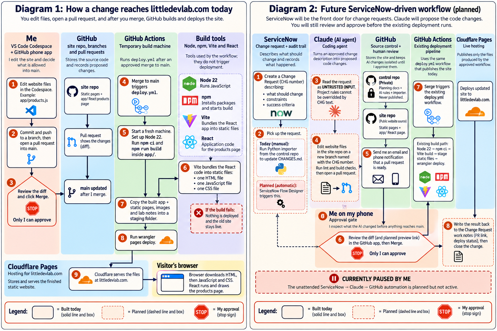
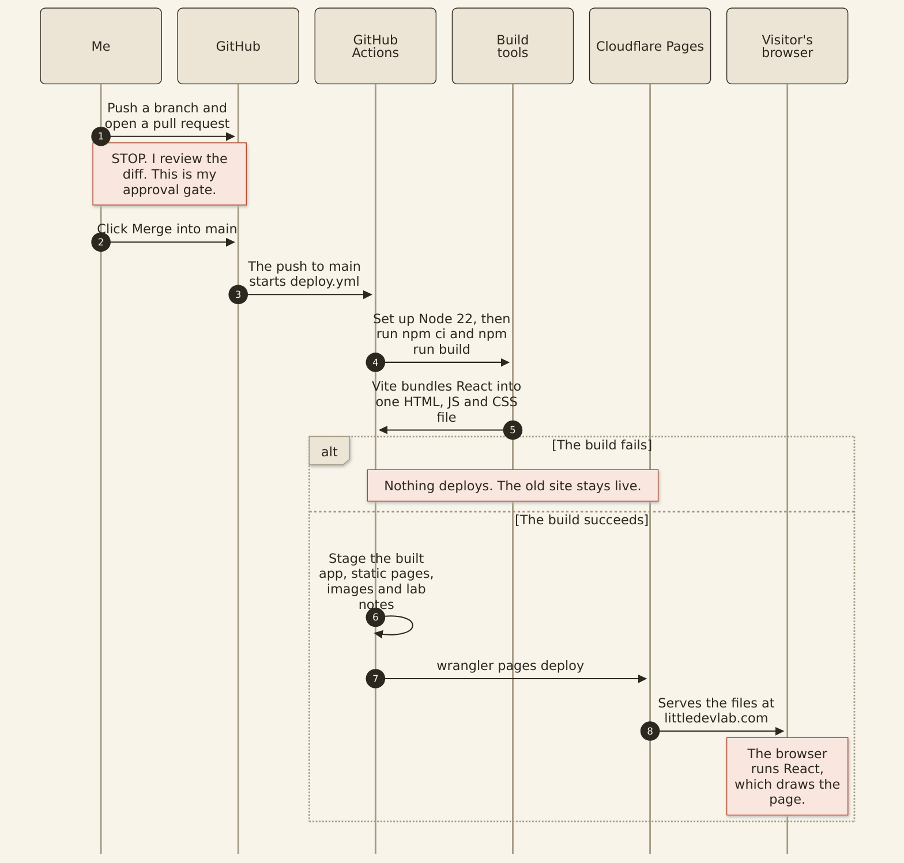
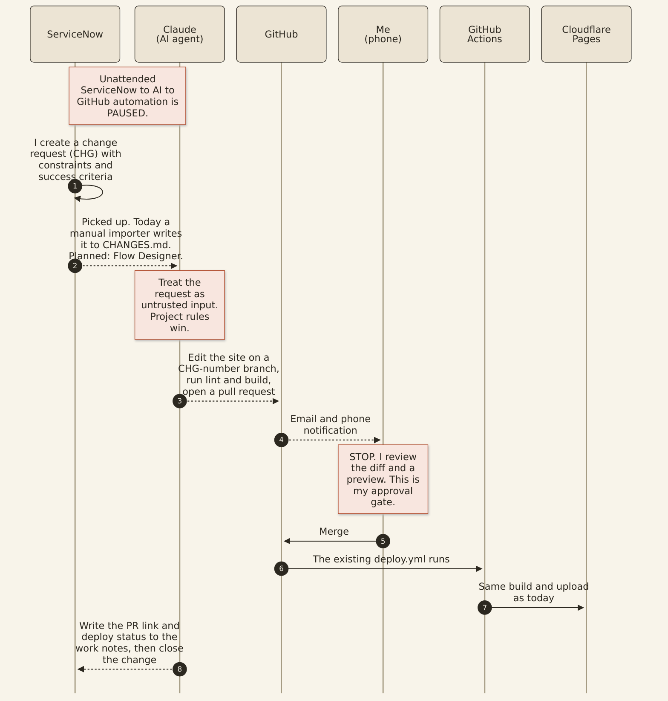

I mapped the build chain, separated “building” from “publishing,” weighed three deployment-trigger options, and ended up with GitHub as the gatekeeper.

<section>

In an effort to “just get it out,” I gave Claude too much agentic power, and it led to my site getting updates I hadn’t expected. I over-rotated and removed all agentic deployment, only to increase the complexity — and to challenge my rusty developer-tool experience.

While mapping how LittleDevLab gets from code to `littledevlab.com`, I realized I had been lumping several very different jobs together. Node, npm, Vite, React, GitHub Actions, Wrangler and Cloudflare all participate in publishing the site, but they do not all do the same thing.

That raised the useful architecture question:

<blockquote><strong>Who should actually be allowed to trigger a production deployment?</strong></blockquote>

This matters even more as I add ServiceNow and an AI coding agent into the workflow. If Claude is allowed to edit code and run builds, I do not want “run a build” to quietly mean “publish this to the internet.”

</section>

<section>

## Proposed Today vs Tomorrow

A detailed review of the current flow vs a proposed future SNOW driven workflow

<figure class="figure-card">

<figcaption class="figure-copy">

<strong>Overview — How a change reaches littledevlab.com today.</strong> I prefer a good icon based image version to help me visualize all of the tools in the CI/CD cycle.

<a href="/images/ldl-deploy-arch-assets/wf-today-tomorrow.png">Open full-size diagram</a>

</figcaption>
</figure>

</section>

<section>

## First: what each piece actually does

### React

React is the JavaScript library the interactive products page is written with. It does not deploy anything. Vite takes the React code and turns it into files a browser can use.

### Vite

Vite is the build tool that bundles the code. In my setup it turns the React app into ordinary static files: HTML, JavaScript and CSS.

### Node

Node is the JavaScript runtime used during the build. GitHub Actions starts a temporary machine with Node installed so the build tools can run.

### npm

npm installs the project dependencies and gives me convenient commands such as `npm ci` and `npm run build`. It can also run a deployment command if I decide to define one.

### Wrangler

Wrangler is the Cloudflare command-line tool that actually uploads the finished files to Cloudflare Pages.

### GitHub Actions

GitHub Actions is the automation engine. It watches for the event I care about — a push to `main`, which in my process means a reviewed pull request was merged — and then runs the build and deployment process.

<blockquote>A trigger decides <em>when</em> something is allowed to happen. A tool performs the work after that decision has been made.</blockquote>

</section>

<section>

## Option 1: building the site automatically deploys it

Option 1
<pre><code>npm run build
      ↓
Vite builds the React app
      ↓
Wrangler deploys it
      ↓
Production changes</code></pre>

The obvious advantage is simplicity: run one command and everything happens. I could wire this through an npm <code>postbuild</code> script, a Vite plugin, or another build hook.

But I want a build to be safe to run anywhere. I should be able to run <code>npm run build</code> in a Codespace just to check whether the code works. Claude should also be able to run builds while validating a change.

If “build” can implicitly change production, then a routine validation command suddenly has a very surprising side effect. That gets especially uncomfortable once an AI agent is involved.

<strong>Decision: rejected.</strong> Building software and publishing software should remain separate operations.

</section>

<section>

## Option 2: let npm own the deployment

Option 2
<pre><code>npm run deploy
      ↓
npm run build
      ↓
Vite builds React
      ↓
Wrangler deploys the result</code></pre>

This is a much better idea. The deployment implementation can live with the project instead of being buried in workflow YAML, and the same command could be used from GitHub Actions or another CI system later.

I actually like that portability. A GitHub Actions workflow could become almost trivial:

<pre><code>npm ci
npm run deploy</code></pre>

But there is still a distinction I want to preserve: npm may know <em>how</em> to deploy, but I do not want npm deciding <em>when</em> production deployment is allowed.

If Cloudflare credentials were available in every environment that could run npm, a developer — or an agent — could bypass the approval path.

<strong>Decision: useful, but not sufficient by itself.</strong> I may package more deployment mechanics into npm later, while keeping the production gate somewhere else.

</section>

<section>

## Option 3: GitHub decides when production deployment happens

Selected

This is the model I am using. One caveat: today it is enforced mostly by my habits, not by GitHub settings. The section on what is locked down covers that.

<blockquote><strong>The trigger is a reviewed pull request being merged into <code>main</code>.</strong></blockquote>

Merge to main
      ↓
GitHub Actions starts deploy.yml
      ↓
Set up Node
      ↓
npm ci
      ↓
npm run build
      ↓
Vite builds the React application
      ↓
Stage the static website files
      ↓
Wrangler uploads them
      ↓
Cloudflare Pages

That gives each part one clear responsibility. GitHub decides <strong>when</strong>. GitHub Actions coordinates <strong>what happens next</strong>. Node/npm/Vite build the application. Wrangler uploads it. Cloudflare serves it.

<strong>Decision: selected.</strong> This gives me the clearest human approval boundary and fits the future ServiceNow + Claude workflow best.

</section>

<section>

## Current workflow

This is the build-and-publish path that exists today. Click the image to open it full size.

<figure class="figure-card">

<figcaption class="figure-copy">

<strong>Diagram 1 — How a change reaches littledevlab.com today.</strong> Everything here is built and working. The note marked STOP is my review.

<a href="/images/ldl-deploy-arch-assets/diagram-1-today.png">Open full-size diagram</a>
<a href="/images/ldl-deploy-arch-assets/diagram-1-today-mermaid.txt">Mermaid source</a>

</figcaption>
</figure>

</section>

<section>

## Why this gets more important with ServiceNow + Claude

The future workflow I am designing gives Claude enough power to do real engineering work without quietly giving it the keys to production.

ServiceNow Change Request
          ↓
Claude reads the request
          ↓
Claude creates a branch
          ↓
Claude modifies the site
          ↓
Claude runs lint + build tests
          ↓
Claude opens a pull request
          ↓
GitHub notifies me
          ↓
        STOP
     I review it
          ↓
     I click Merge
          ↓
GitHub Actions deploys
          ↓
Cloudflare Pages

The key word there is **STOP**. Claude can write most or even all of a change, but the branch is not production. A pull request is not production. Even a successful production build is not production.

Only a merge to `main` starts a deployment. Whether that is really only me depends on what GitHub enforces, which is the next section.

<figure class="figure-card">

<figcaption class="figure-copy">

<strong>Diagram 2 — Planned ServiceNow-driven workflow.</strong> Solid arrows exist today. Dashed arrows are planned, not built. The notes mark the pause on unattended automation and my review.

<a href="/images/ldl-deploy-arch-assets/diagram-2-future-servicenow.png">Open full-size diagram</a>
<a href="/images/ldl-deploy-arch-assets/diagram-2-future-servicenow-mermaid.txt">Mermaid source</a>

</figcaption>
</figure>

</section>

<section>

## What is locked down now

Labeling my review an “approval gate” on a diagram is not the same as GitHub enforcing it. When I first published this note, the gaps were real: `main` had no protection, any branch could deploy by hand, the Cloudflare credentials were readable from any branch, and nothing checked a pull request before I merged it. Within a day of publishing, I closed all four.

### Enforced now

- A failed build stops the deployment before Wrangler runs.
- **Changing `main` takes a pull request.** A ruleset on `main` requires a pull request and a passing build check, and it blocks force pushes and deleting the branch. The first time I tried to edit a file on `main` in GitHub’s web editor afterward, it refused and offered to make a new branch instead.
- **Only `main` deploys.** The deploy job checks the branch before it runs, so a manual run started from any other branch is skipped.
- **The Cloudflare credentials belong to `main`.** They live in a GitHub environment named `production` that only `main` can use. I created a new Cloudflare token for it, scoped to one account, instead of moving the old one, which could reach every account.
- **Every pull request is linted and built.** A separate workflow runs lint, the Vite build and the same staging step as the deploy. It has no Cloudflare access. It passed on its first run.
- My Codespace login can push content, but GitHub will not let it change the workflow files. I found that out when a push was rejected. I kept it that way, so I made every workflow change on this list myself in GitHub’s web editor, each through its own pull request.

### What it still does not do

The ruleset requires a pull request, but zero approvals. I work alone, and GitHub does not let me approve my own pull request. That means anything with write access, including my Codespace login, can open a pull request and merge it once the check is green. The rule guarantees a pull request and a passing build. The review is still mine to do.

One cleanup came out of this too. The deploy workflow had a step that created the Cloudflare Pages project. It only mattered on the first deploy, and after that it logged “Action failed” on every run while the deploy itself succeeded. A fake failure on every run teaches you to ignore real ones, so I removed it and updated the workflow’s actions to their current versions in the same pull request.

“My approval gate” now describes what GitHub prevents, not just the process I follow, with the one caveat above.

</section>

<section>

## Failure behavior: another reason I like this model

If I merge a change and the build fails, the deployment stops before Wrangler runs. Cloudflare continues serving the previous version.

Merge to main
      ↓
Attempt build
      ↓
   Success?
   /     \
 No       Yes
 ↓         ↓
STOP     Deploy
 ↓
Old site remains live

A broken build does not automatically become a broken website. That is exactly the behavior I want.

</section>

<section>

## Final workflow plan

<table>
<thead>
<tr><th>Component</th><th>Responsibility</th></tr>
</thead>
<tbody>
<tr><td><strong>GitHub</strong></td><td>Decides when: a merge to <code>main</code> starts a deployment.</td></tr>
<tr><td><strong>GitHub Actions</strong></td><td>Orchestrates the build and deployment.</td></tr>
<tr><td><strong>Node / npm / Vite</strong></td><td>Build the application.</td></tr>
<tr><td><strong>React</strong></td><td>The library the products page is written with.</td></tr>
<tr><td><strong>Wrangler</strong></td><td>Uploads the finished static site.</td></tr>
<tr><td><strong>Cloudflare Pages</strong></td><td>Hosts and serves the finished site.</td></tr>
</tbody>
</table>

I may still move more of the deployment mechanics into `package.json` later. For example, GitHub Actions could eventually run:

<pre><code>npm ci
npm run deploy:production</code></pre>

That would give me the portability of npm without changing the approval model.

</section>

<section class="rule">
<strong>The rule I am keeping:</strong>

GitHub controls <em>when</em>. 
Node, npm and Vite handle <em>how</em> the application is built. 
Wrangler performs the upload. 
Cloudflare serves the result.

<strong>Most importantly: building the website is not permission to publish the website.</strong>

</section>
