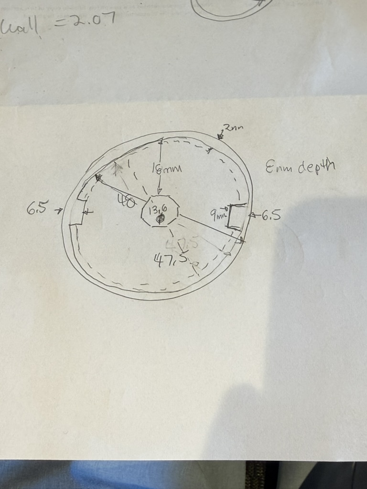
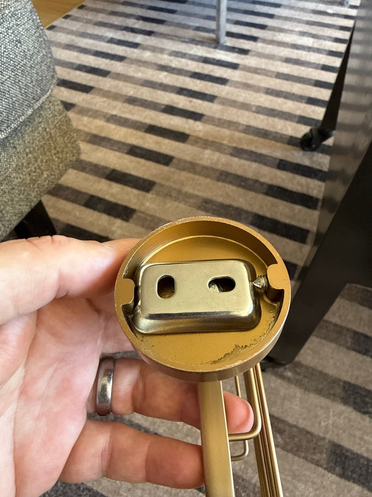
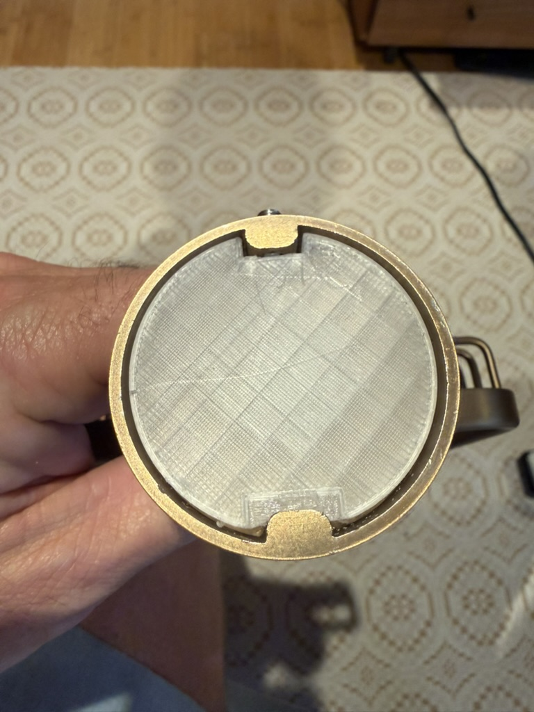

Small, fiddly fit problem: adapting a 3D-printed “puck” that mounts a Volkano/ICO Summit V6359 soap basket into its brass escutcheon on the wall. The escutcheon is a cast-metal cavity with tight, non-standard tolerances — no datasheet, just calipers and dry-fit iteration.

## The Fixture: No Datasheet, Just Calipers

The escutcheon itself only gives up its geometry the slow way — measure, sketch, print, test, remeasure. First pass at capturing the cavity by hand:

<figure class="post-figure">

<figcaption>First-pass caliper measurements of the escutcheon cavity, sketched by hand before anything got modeled — wall thickness, cavity depth, and the offset nub geometry that the puck has to clear.</figcaption>
</figure>

Those measurements fed the fixture geometry that the parametric model is built against:

<ul class="spec-list">
<li>Escutcheon OD: 52.00 mm</li>
<li>Cavity ID at opening: 48.00 mm</li>
<li>Cavity ID deeper in the cup: ~47.50 mm</li>
<li>Cavity depth: ~8.00 mm</li>
<li>Set-screw-side boss: ~9.00 mm wide</li>
<li>Center nut/bolt: ~13.60 mm across flats, ~3.60 mm high</li>
</ul>

<figure class="post-figure">

<figcaption>The escutcheon’s backside — the keyhole mounting bracket and set screw that the printed puck has to key around, not just fit inside.</figcaption>
</figure>

## Approach: Parametric CAD Instead of Freehand Modeling

Rather than modeling this by hand in a GUI, I built it parametrically in CadQuery (Python-based CAD) so every dimension — OD, depth, notch widths, the angled retaining-nub geometry — is a named variable at the top of the script. That made it fast to push a new revision after each dry-fit test instead of re-drawing geometry by hand.

Each revision exports STEP + STL + a 3MF for slicing, runs a validation pass (STEP bounding box vs. mesh watertightness check via `trimesh`), and generates a README plus an SVG cross-section profile documenting the retaining-nub cut — so every revision is self-documenting.

## The Iteration History

<ol class="rev-list">
<li><strong>Rev B:</strong> First working geometry. The basket rotated flat successfully, but the angled retaining nub didn’t enter easily — had to hand-shave ~3 mm off the ramp to get it to seat.</li>
<li><strong>Rev C:</strong> Folded that fix back into the model — moved the capture-ridge boundary inward by 3 mm, widened the nub window from 12.5 mm to 15.5 mm to tolerate print variance, and bumped axial depth to 6.60 mm. Also learned the PETG prints dimensionally large, so the max OD shifted down 0.2 mm (46.90 mm nominal) to compensate.</li>
<li><strong>Rev C’s real upgrade:</strong> redesigned the retaining-nub cut from a single one-way ramp into a two-stage “hourglass” pocket — a generous entry pocket, a short capture ridge, then a generous seated pocket — so the nub gets a real lead-in path before it has to clear the retaining ridge, instead of fighting interference on entry.</li>
<li><strong>Rev E:</strong> Increased overall axial depth to 8.5 mm — a deliberate last-minute bump, sized up specifically to make the change easier to see while checking the geometry in the OCP CAD Viewer — keeping the Rev C nub geometry and screw-boss notch unchanged since those already tested well.</li>
</ol>

<figure class="post-figure">

<figcaption>Rev E nominal print, dry-fit in the escutcheon — no adhesive, just checking that the angled-nub pocket and set-screw boss line up before committing.</figcaption>
</figure>

## Tooling

<ul class="spec-list">
<li>Parametric script in CadQuery, run from a dedicated Python 3.12 venv kept outside the iCloud-synced project folder — venvs are thousands of small files, and letting iCloud sync/evict them is a bad idea.</li>
<li>OCP CAD Viewer extension for VS Code, for live geometry preview while iterating on dimensions, plus its built-in measure tool to double-check specific distances and angles against the real fixture measurements.</li>
<li>A validation script that diffs the STEP bounding box against the exported mesh on every build, so a bad export or dimension typo gets caught immediately rather than at the printer.</li>
</ul>

## Status

Rev E is packaged and ready to print — a nominal variant and a 0.2 mm-loose variant, both watertight per the validation pass. Next step is the physical dry-fit against the real escutcheon.
